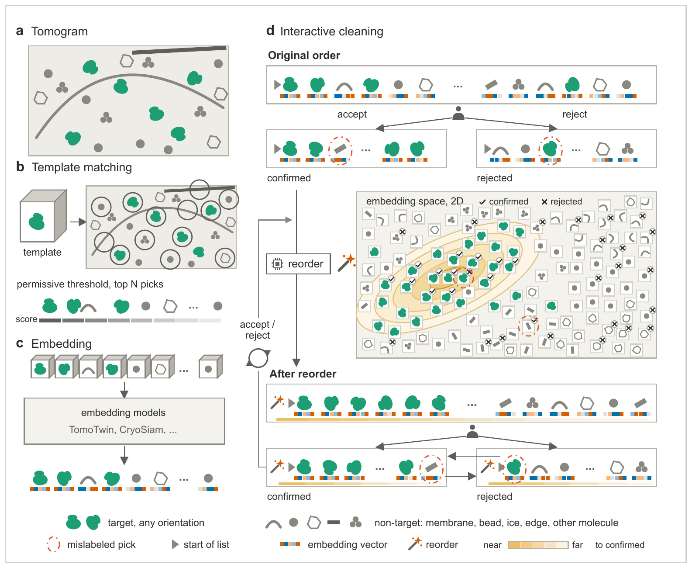
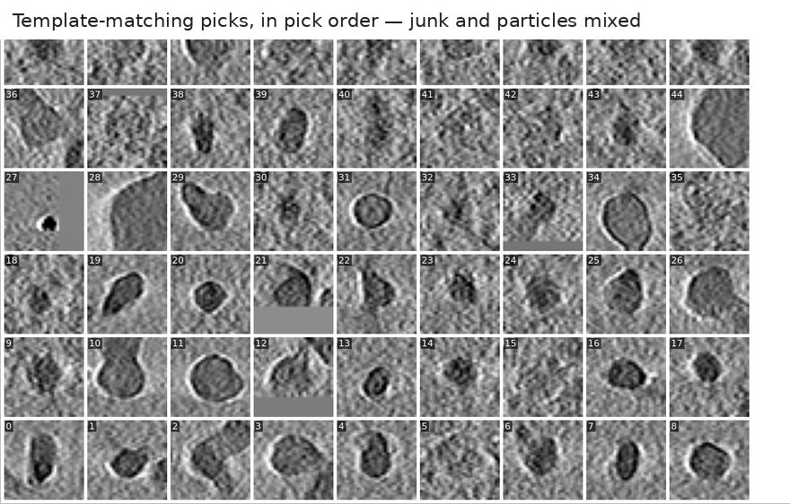

# PickyMate

Interactive, iterative curation of template-matching picks in cryo-electron
tomograms, ranked by pretrained-model embeddings.



Template matching with a permissive threshold retrieves most of the true
particles, buried among many more false positives (**a**, **b**). PickyMate
embeds every candidate once with a pretrained model such as TomoTwin or
CryoSiam (**c**) and turns the curation into a loop (**d**): confirm a few
good particles, reject some junk, and press *reorder*. Every list is
re-ranked, in real time, by the Mahalanobis distance of each pick's embedding
to the confirmed picks, optionally minus its distance to the rejected ones.
Lookalikes of what you confirmed rise to the head of the unvisited list,
where you confirm them in bulk; lookalikes of what you rejected sink.
Mistakes surface too: a wrongly rejected particle rises to the front of the
rejected list, a wrongly confirmed one sinks to the end of the confirmed
list. Because the embeddings are comparable across tomograms, the decisions
made in the tomograms you have finished rank the ones you have not opened
yet.

The moment that matters, live from the app: a few confirmed particles, one
click, and thousands of picks reorder around them.



On the ten defocus tomograms of EMPIAR-10988, re-ranking saved about 40% of
the curator's decisions, and the curated picks averaged to better resolutions
than the deposited annotations while adding 4,695 ribosomes and 390 fatty
acid synthase particles the annotation had missed. The numbers are in
[Ranking by Embedding Distance](docs/ranking.md#what-it-buys-you) and in the
paper.

## Install

Python 3.10 or later. Straight from GitHub:

```
pip install git+https://github.com/Image-Analysis-Hub/PickyMate.git
```

or editable from a clone, so that updating the clone needs no reinstall:

```
git clone https://github.com/Image-Analysis-Hub/PickyMate.git
cd PickyMate
pip install -e .
```

In a fresh conda environment, create it first:
`conda create -n pickymate python=3.12 pip`, then `conda activate pickymate`.

## Run

```
pickymate tomogram.mrc                 # one tomogram
pickymate --session session.csv        # a whole dataset
```

## Tutorial

[tutorial/](tutorial/) walks through a complete session on two EMPIAR-10988
tomograms, from the first hand-picked references to ranking the second
tomogram with the decisions made in the first. The picks and their TomoTwin
embeddings are included; only the two tomograms are downloaded. About
30 minutes.

## Documentation

[docs/](docs/index.md) is the user guide, one page per part of the interface,
plus how to prepare the inputs:

- [Getting Started](docs/getting-started.md) — running, command-line options,
  the two windows.
- [Picking and Tools](docs/picking-and-tools.md) — Pick, Eraser, Select,
  Recycle Bin and Confirmed.
- [The Particle List](docs/particle-list.md) — the thumbnail gallery and sets.
- [Ranking by Embedding Distance](docs/ranking.md) — the heart of the tool.
- [Sessions and UMAP Maps](docs/sessions-and-umap.md) — a whole dataset at
  once.
- [Selection, Undo, and Saving](docs/selection-and-saving.md),
  [Keyboard Shortcuts](docs/keyboard-shortcuts.md),
  [Files on Disk](docs/files-on-disk.md).

## Tools

- `tools/tomotwin_embed_picks.py` and `tools/cryosiam_embed_picks.py` embed a
  picks file at its coordinates with a stock TomoTwin or CryoSiam
  installation; see [Preparing the inputs](docs/index.md#preparing-the-inputs).
- [tools/benchmarking/](tools/benchmarking/) — the three experiments of the
  paper's benchmark, run with the ranking code of the application.

## Citation

Abosinnee A., Bencsik G., Tinevez J.-Y., Harastani M. *PickyMate: Interactive
& Iterative Curation of Cryo-Electron Tomography Template Matching
Annotations Using Pretrained Model Embeddings.* Manuscript; a link will be
added here once it is available.

PickyMate is released under the BSD 3-Clause License.
