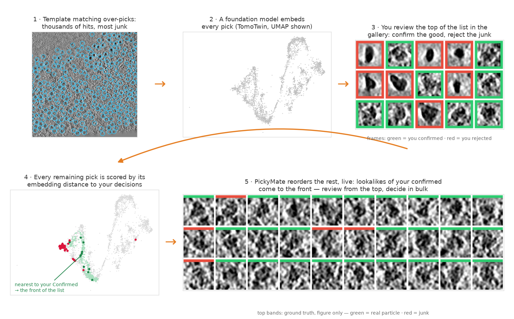

# PickyMate

Interactive curation of particles picked in cryo-electron tomograms.

Template matching (or any picker) finds your particles, but it over-picks:
thousands of hits, most of them junk. PickyMate turns cleaning that list from
a one-by-one slog into a few rounds of bulk decisions. Every pick carries a
foundation-model embedding (TomoTwin, CryoSIAM); as you confirm good
particles and reject junk, PickyMate re-ranks everything else by similarity
to your own decisions — live, while you work — so lookalikes of what you
confirmed come to you and lookalikes of what you rejected sink away. The same
works across a whole dataset: decisions made in the tomograms you have
finished re-rank the ones you have not opened yet.



The moment that matters, live from the app — you confirm a few good
particles, and one click reorders thousands of picks around them:


Everything can also be fixed by hand — three orthogonal slice views, click
to add or remove a pick, organize into sets, all saved as plain `x y z`
text files. But start from the template-matching list: only its picks carry
embeddings, so a particle picked by hand cannot take part in the ranking.

## Install

With conda (creates a `pickymate` environment with the `pickymate` command):

```
git clone https://github.com/Image-Analysis-Hub/PickyMate.git
cd PickyMate
conda env create -f environment.yml
conda activate pickymate
```

Into an environment you already have — editable from a clone, or straight
from GitHub:

```
pip install -e .                # from inside the clone; edits take effect immediately
pip install git+https://github.com/Image-Analysis-Hub/PickyMate.git
```

## Run

```
pickymate tomogram.mrc                 # one tomogram
pickymate --session session.csv        # a whole dataset
```

## Documentation

[docs/](docs/index.md) — a short, searchable user guide:

- [Getting Started](docs/getting-started.md) — running, command-line options,
  the two windows.
- [Picking and Tools](docs/picking-and-tools.md) — Pick, Eraser, Select, and
  the Recycle Bin / Confirmed workflow.
- [The Particle List](docs/particle-list.md) — the thumbnail gallery and sets.
- [Ranking by Embedding Distance](docs/ranking.md) — the heart of the tool.
- [Sessions and UMAP Maps](docs/sessions-and-umap.md) — many tomograms at
  once, and selecting particles directly on the embedding map.
- [Selection, Undo, and Saving](docs/selection-and-saving.md)
- [Keyboard Shortcuts](docs/keyboard-shortcuts.md)
- [Files on Disk](docs/files-on-disk.md) — every file PickyMate reads or
  writes, all plain text.
