# PickyMate tutorial — curating template-matching ribosome picks

This tutorial walks through a complete PickyMate session on two tomograms
from EMPIAR-10988 (*S Pombe* DEF dataset, TS_027 and TS_028). Both
tomograms come with ribosome picks from template matching (GapStop) and the
TomoTwin embeddings of those picks. Template matching over-picks: TS_027 has
8,185 candidates and TS_028 has 16,737, and a large share of them are false
positives. You will clean these lists in bulk instead of one by one:

1. confirm a handful of good ribosomes and reject some junk by hand,
2. rank everything else by embedding similarity to your own decisions,
3. confirm hundreds of particles at a time, re-rank, repeat,
4. open the second tomogram and rank it with the decisions made in the first
   before touching a single particle in it,
5. look at the embeddings of both tomograms on one UMAP map.

Plan on about 30 minutes. If you have not
installed PickyMate yet, see the
[Getting Started guide](https://github.com/MohamadHarastani/PickyMate/blob/main/docs/getting-started.md)
first.

## Contents

- [1. What is in the tutorial folder](#1-what-is-in-the-tutorial-folder)
- [2. Download the tomograms and start the session](#2-download-the-tomograms-and-start-the-session)
- [3. The session navigator](#3-the-session-navigator)
- [4. Getting oriented in TS_027](#4-getting-oriented-in-ts_027)
- [5. Seed the two reference sets by hand](#5-seed-the-two-reference-sets-by-hand)
- [6. A first look at the UMAP map](#6-a-first-look-at-the-umap-map)
- [7. The first ranking](#7-the-first-ranking)
- [8. Reject everything outside the region of interest](#8-reject-everything-outside-the-region-of-interest)
- [9. The confirm – re-rank loop](#9-the-confirm--re-rank-loop)
- [10. Audit the Confirmed set and the Recycle Bin](#10-audit-the-confirmed-set-and-the-recycle-bin)
- [11. Open TS_028 and reuse your decisions](#11-open-ts_028-and-reuse-your-decisions)
- [12. One UMAP map for the whole session](#12-one-umap-map-for-the-whole-session)
- [13. Where your work is saved](#13-where-your-work-is-saved)
- [Shortcuts used in this tutorial](#shortcuts-used-in-this-tutorial)

## 1. What is in the tutorial folder

```
Tutorial/
├── session.csv              ← the session manifest: one row per tomogram
├── tutorial.txt             ← the download and launch commands (same as below)
├── GapStop_ribosomes/       ← template-matching picks, plain "x y z" text
│   ├── TS_027.txt             8185 picks
│   └── TS_028.txt             16737 picks
├── TomoTwin/                ← TomoTwin embeddings of exactly those picks
│   ├── TS_027.temb / TS_027.tumap
│   └── TS_028.temb / TS_028.tumap
└── tomograms/               ← empty: you download TS_027.rec and TS_028.rec here
```

`session.csv` ties the pieces together. Its columns are the same as
PickyMate's command-line options, and relative paths resolve against the
folder the manifest is in:

```
tomogram,working_dir,embedded_particle_list,tomotwin_embeddings,tomotwin_umap
tomograms/TS_027.rec,TS_027_picks,GapStop_ribosomes/TS_027.txt,TomoTwin/TS_027.temb,TomoTwin/TS_027.tumap
tomograms/TS_028.rec,TS_028_picks,GapStop_ribosomes/TS_028.txt,TomoTwin/TS_028.temb,TomoTwin/TS_028.tumap
```

`working_dir` is where PickyMate will write its results (`TS_027_picks/` and
`TS_028_picks/`); those folders do not exist yet and are created on first
open.

## 2. Download the tomograms and start the session

The two tomograms (1.8 GB and 0.9 GB) are fetched straight from
EMPIAR:

```bash
cd Tutorial/tomograms
wget https://ftp.ebi.ac.uk/empiar/world_availability/10988/data/DEF/tomograms/TS_027.rec
wget https://ftp.ebi.ac.uk/empiar/world_availability/10988/data/DEF/tomograms/TS_028.rec
cd ..
```

Then, from the `Tutorial/` folder:

```bash
conda activate pickymate
pickymate --session session.csv
```

The terminal confirms that the picks were imported with their embeddings
attached, once per tomogram as each is opened for the first time:

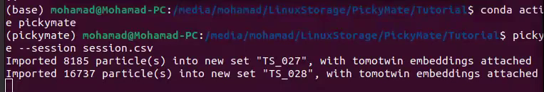

Import happens only on a tomogram's first open. Later, the same command
simply resumes from the working directories.

## 3. The session navigator

Three windows open: the **session navigator**, the **tomogram window**
(`PickyMate — TS_027`) and the **Particle List** (the thumbnail gallery). The
navigator lists every tomogram of the manifest with its progress. TS_027 is
opened automatically; TS_028 shows *not started* because it has no working
directory yet.

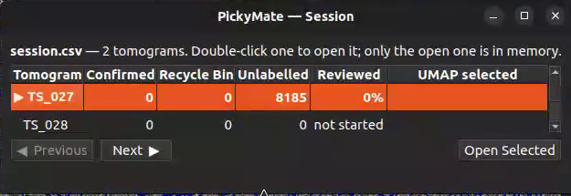

Only the open tomogram is in memory. Double-click a row (or use **Previous /
Next**, or **Ctrl+PgDown / Ctrl+PgUp**) to switch; PickyMate saves everything
first. You can start with either tomogram — this tutorial starts with TS_027.

## 4. Getting oriented in TS_027

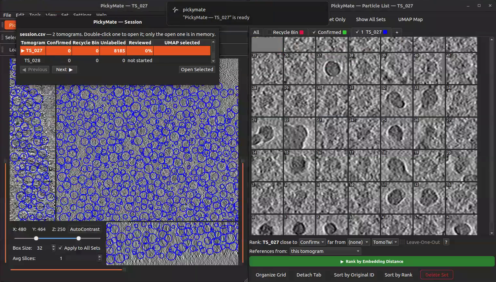

What you see:

- **Tomogram window** — the XY slice in the middle, the ZY view on the left,
  the XZ view at the bottom. The bottom slider (or Shift+wheel) steps through
  Z. Every pick is drawn as a blue circle — the colour of the `TS_027` set.
- **Particle List** — one tab per set: **All**, **Recycle Bin** (red),
  **Confirmed** (green), and **TS_027** (blue), which holds the imported
  picks. The two fixed sets are empty for now. Thumbnails are laid out from
  the bottom-left upwards, so particle 0 is at the bottom-left and the
  gallery grows upward as you scroll.
- **Ranking row** above the gallery toolbar — the heart of the tool, used
  from section 7 on.

Before deciding anything, look at the tomogram itself:

1. **Hide the picks** — untick the visibility checkbox on the `TS_027` tab
   (the checkbox left of the tab name). The circles disappear from the
   tomogram views and the cell becomes readable: a region of cytoplasm, a
   nucleus, and the cell border running diagonally across the slice.
2. **Average slices** — this tomogram is not denoised. Set **Avg Slices** to
   `5` (bottom-left of the tomogram window). Each view and every thumbnail
   now show the mean of 5 slices, which lifts the contrast without blurring
   the ribosomes. Values up to about 5 help; beyond that the image gets
   blurry.
3. Optionally shrink **Box Size** for a moment (e.g. to 10) to see the
   underlying density under the circles, then set it back to 32.

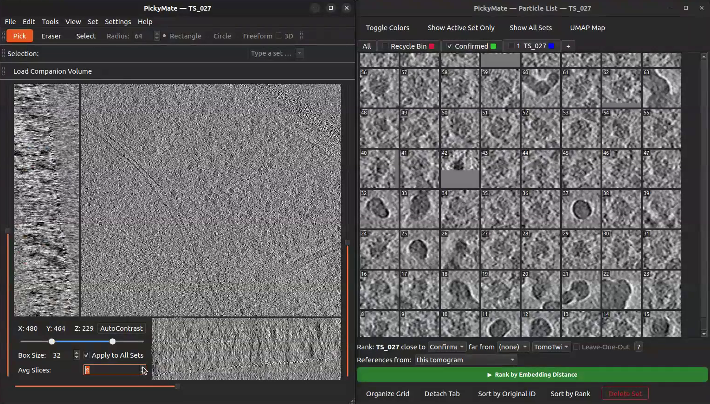

Scroll through the gallery (wheel zooms, right-drag pans) and you see the
typical template-matching result: many real ribosomes, interleaved with
false positives — and the further you go up the list, the more false
positives there are.

## 5. Seed the two reference sets by hand

Ranking learns from two sets, **Confirmed** and **Recycle Bin**. Give it a
few examples of each.

**Reject obvious junk.** Hold **Shift** and left-click a false positive in
the gallery: it moves to the Recycle Bin and leaves a gap. After a few,
press **Organize Grid** (gallery toolbar) to close the gaps.

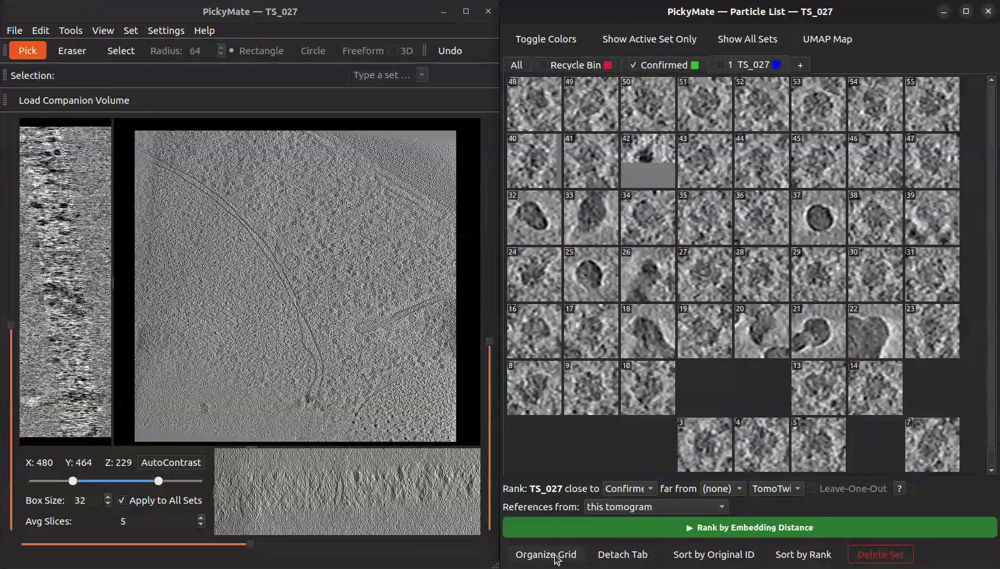

**Confirm good ribosomes.** Build a selection of candidates first —
**Ctrl+click** toggles a thumbnail, **Alt+click** range-selects — then switch
on **Show Only Selected** on the tomogram window's Selection toolbar (widen
the window if the button is hidden). With the picks hidden, only the
selected particles are drawn in the tomogram views, so you can click each one
in the gallery and check it in the slices before committing.

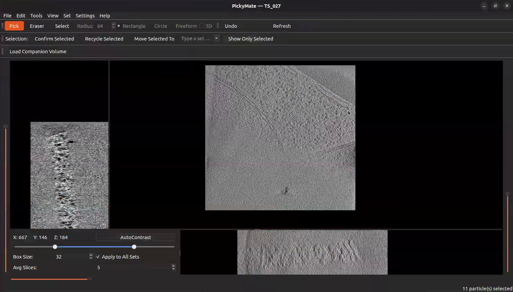

When you are sure, press **Confirm Selected** (Selection toolbar, or the
**Insert** key). In the recording, 11 particles go into Confirmed and a few
into the Recycle Bin — that is enough to start ranking.

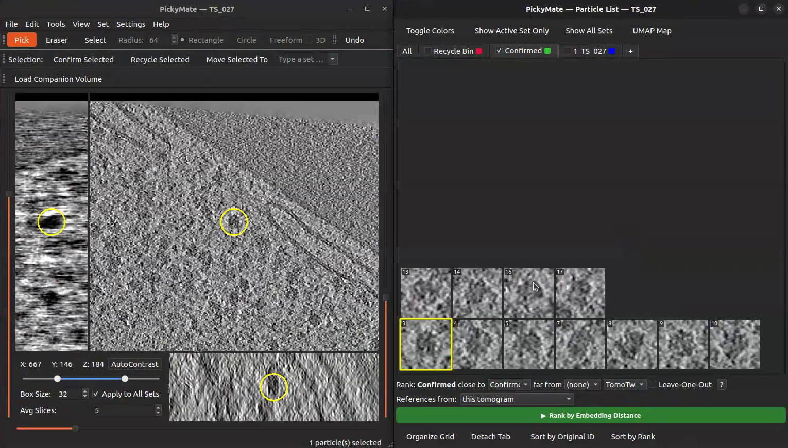

Other ways to do the same: **Space+click** a particle to confirm it directly,
**Shift+click** to reject it, in the gallery or in any tomogram view.

## 6. A first look at the UMAP map

Each pick is embedded by TomoTwin as a 32-dimensional vector; the `.tumap`
file holds a 2-D UMAP of those vectors. Press **UMAP Map** (Particle List
toolbar) to see it.

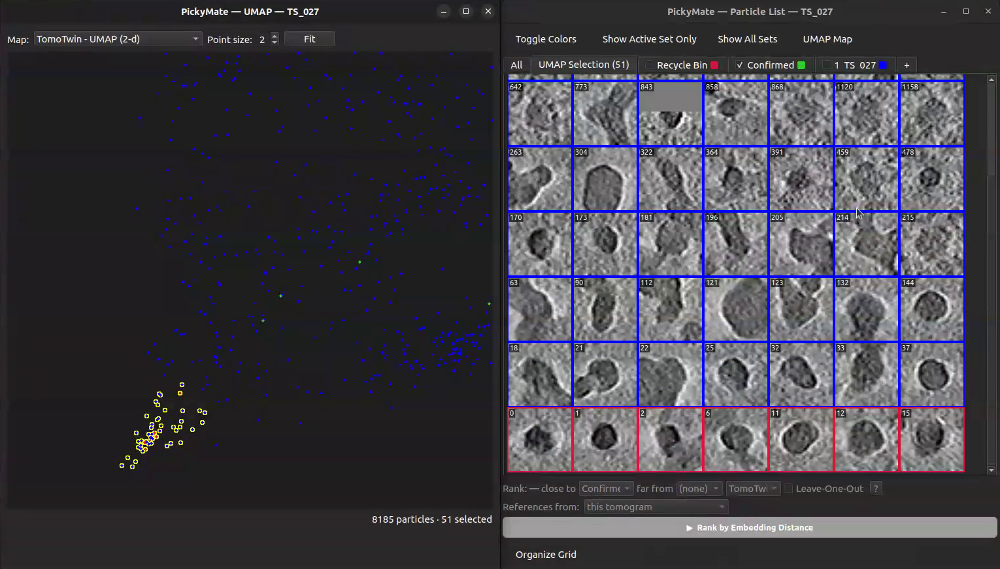

Points are coloured by set (confirmed green, rejected red, the rest blue),
and update as you work. **Drag** a lasso to select a region: the selection
immediately appears as a **UMAP Selection** tab in the Particle List, so you
can inspect the thumbnails and confirm or recycle from there.

Try lassoing around your confirmed particles. A region at the edge of the
dense cluster mixes true particles with ice contamination; a region in the
core is mostly ribosomes with some junk in between. Isolating a clean subset
in 2-D is not easy — which is the point: the 2-D map is good for *visual*
assistance, but the ranking in the next step is done in the full 32-D space,
where the separation is much better.

## 7. The first ranking

Go to the `TS_027` tab and look at the ranking row:

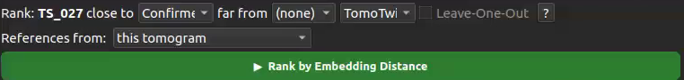

- **Rank TS_027 close to** `Confirmed` — the set to resemble.
- **far from** `(none)` for now.
- space dropdown: `TomoTwin - full (32-d)` — the full embedding, not the 2-D
  UMAP.
- **References from** `this tomogram` — becomes useful in section 11.

Press **▶ Rank by Embedding Distance**. A dialog reports the result — here
*Scored 8167 particle(s) in "TS_027" — close to 11 particle(s) in
"Confirmed"* — and the tab is re-laid out best first: the particles most
similar to your 11 confirmed ribosomes now sit at the bottom-left of the
gallery, the least similar at the top.

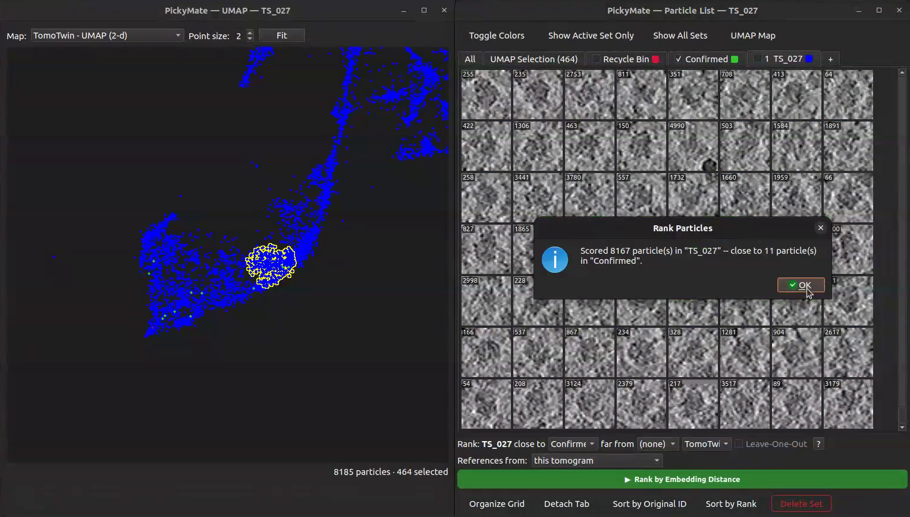

The score is a Mahalanobis distance: how many standard deviations a particle
sits from the mean of the Confirmed set, taking the spread of that set into
account. Ranking is a one-shot sort — later edits do not reshuffle it.
**Sort by Rank** re-applies the last scores at any time, and **Sort by
Original ID** returns to the template-matching order, so you can compare
the two.

## 8. Reject everything outside the region of interest

A single distance already helps. The ranking gets better with a second
reference: **far from** `Recycle Bin` turns the score into
`distance to Confirmed − distance to Recycle Bin` (a *relative* Mahalanobis
distance), so lookalikes of your rejected particles sink as well. For that
the Recycle Bin must represent the real false positives — and right now it
holds only the handful you clicked.

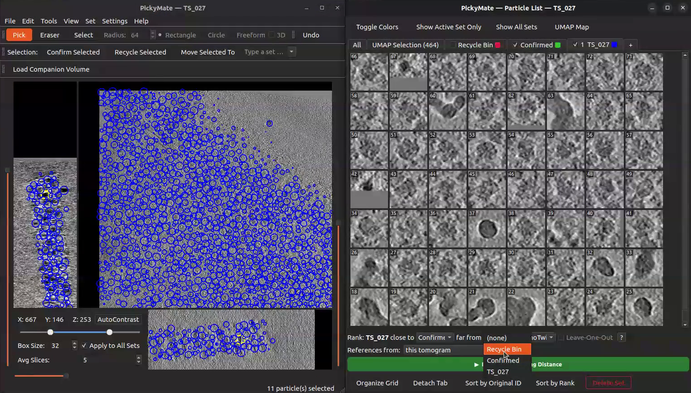

The fastest way to fill it is to reject, in bulk, everything the template
matcher put outside the cytoplasm: the nucleus and the slab borders.

**Erase the nucleus.** Pick the **Eraser** tool and tick **3D** so it clears
a sphere rather than one slice. With the default **Radius** of 64, trace
carefully along the nuclear boundary; then raise the Radius to 128 and sweep
the interior of the nucleus. Everything erased goes to the Recycle Bin.

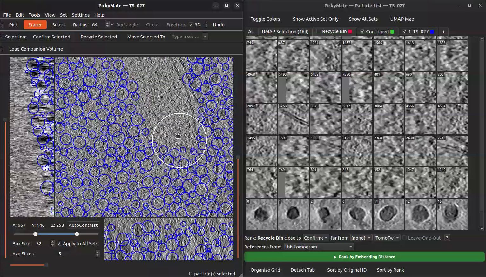

**Select the slab borders in the side views.** Switch to the **Select**
tool, keep **3D** ticked and **Rectangle** chosen, and draw the rectangle in
the ZY view (left) or the XZ view (bottom) rather than in XY: a 3-D
rectangle drawn there extrudes through the whole volume and catches every
pick above or below the ice slab in one go. The count appears at the bottom
right of the tomogram window — 729 particles in the recording. Press
**Recycle Selected** (or the **Delete** key).

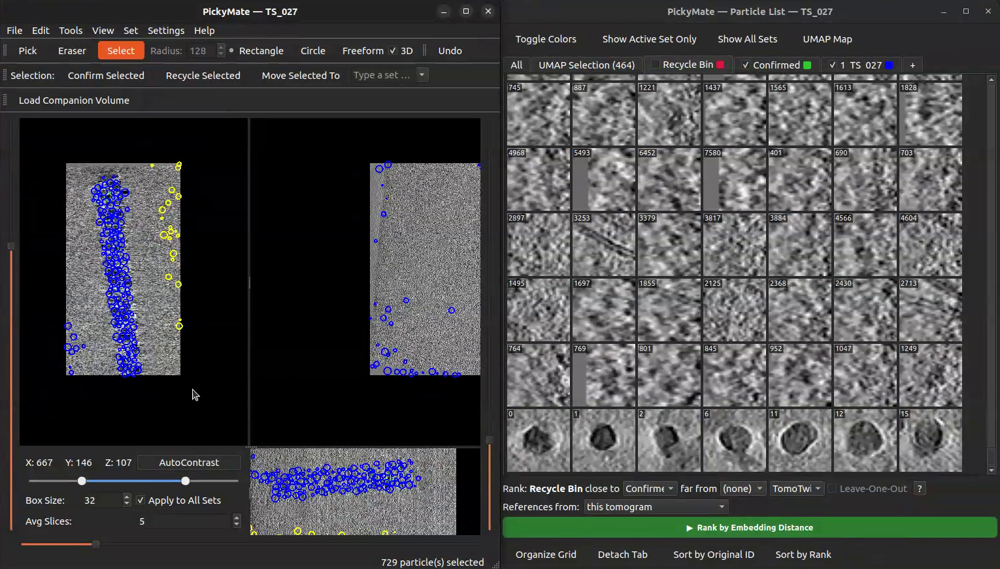

The Recycle Bin now holds thousands of picks instead of a few:

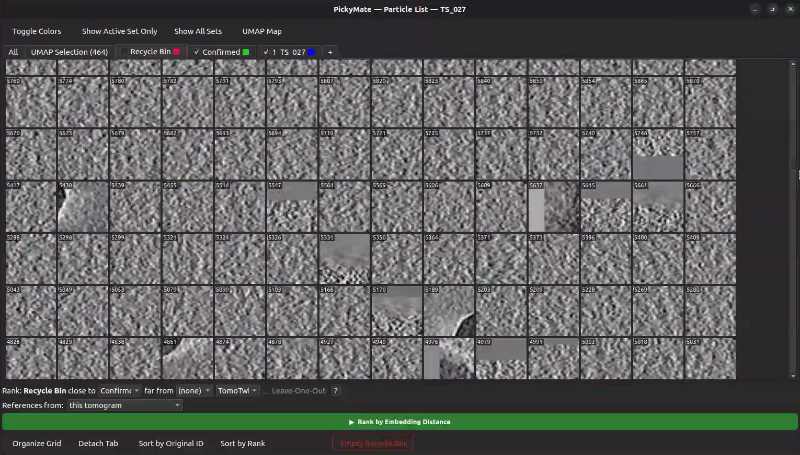

Do not worry about ribosomes caught by mistake. Nothing is discarded —
section 10 shows how to find and rescue them.

## 9. The confirm – re-rank loop

Back on the `TS_027` tab, set **far from** to `Recycle Bin` and press **Rank
by Embedding Distance** again. From here on the work is a loop:

1. Scroll from the start of the ranked list (bottom-left). Click the first
   thumbnail, **Alt+click** the last one you are happy with, and press
   **Confirm Selected** — hundreds of particles at once.
2. Shift+click the occasional false positive you spot on the way.
3. Re-rank. It takes about a second, and every added decision sharpens the
   next ranking: a false positive that was sitting among the good particles
   will drift further away each time.
4. Repeat until the start of the list turns into junk.

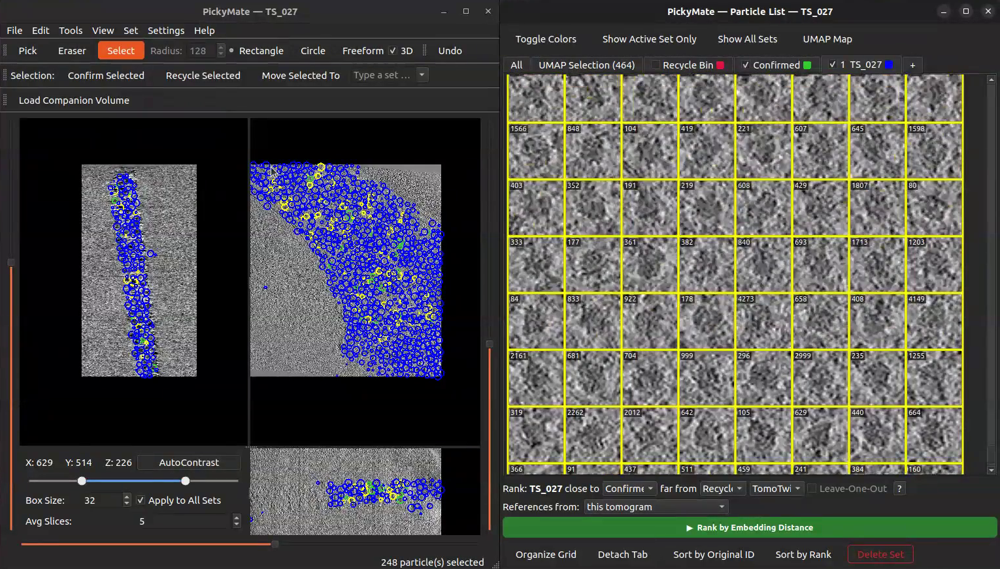

Some border artefacts will keep showing up among the good particles even
after several rounds — the embeddings are not perfect. Just reject them as
you go, or make an extra pass with the Eraser along the borders.

## 10. Audit the Confirmed set and the Recycle Bin

The two reference sets can be ranked against each other too, which turns
them into a review tool.

**Did junk slip into Confirmed?** Open the `Confirmed` tab and rank it with
the same settings (close to Confirmed, far from Recycle Bin). Particles that
do not resemble the rest of the set sink to the end of the list — at the top
of the gallery — where you can reject them. In the recording a junk particle
is confirmed on purpose to show this; after ranking it lands at the end.

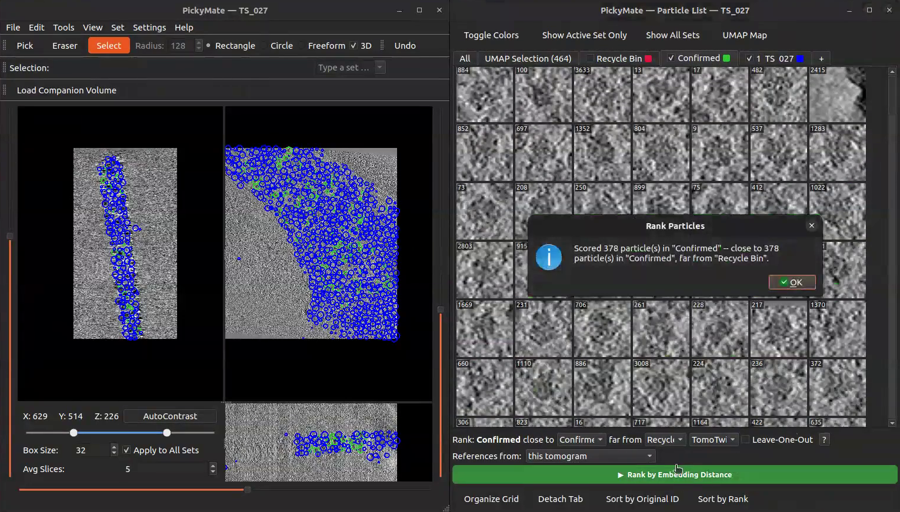

**Did ribosomes end up in the Recycle Bin?** Open the `Recycle Bin` tab and
rank it close to Confirmed. The most ribosome-like rejects come first. Many
of them are pre-ribosomal particles from the nucleus — rightly rejected, but
understandably similar. Click through them; when one is a genuine
cytoplasmic ribosome, **Space+click** it (or select and **Confirm Selected**)
to bring it back.

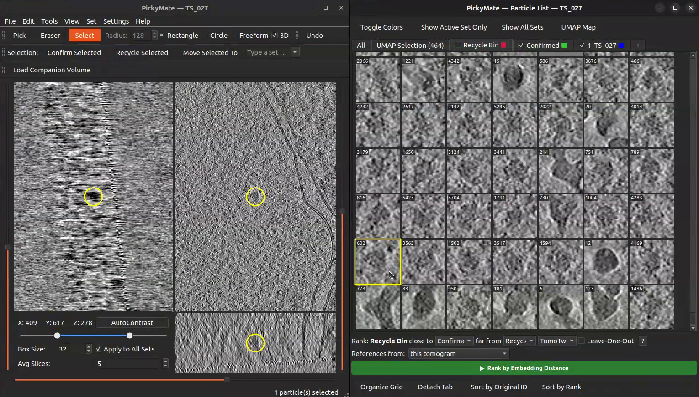

Continue the loop of section 9 until you are satisfied. At the point where
the recording moves on, TS_027 stands at 656 confirmed, 3,970 in the Recycle
Bin and 3,559 still unvisited.

## 11. Open TS_028 and reuse your decisions

Switch tomograms from the navigator: double-click **TS_028** (or press
**Ctrl+PgDown**). The navigator re-reads every working directory and shows
TS_027's progress — confirmed, recycled, unlabelled, and the share reviewed.

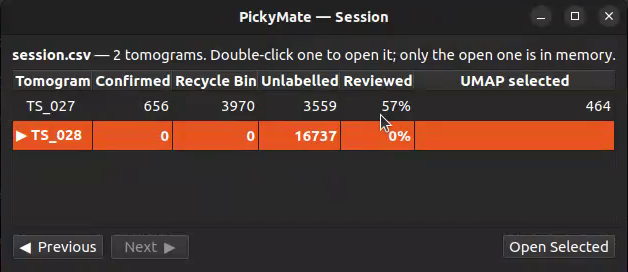

TS_028 is a richer tomogram, almost entirely cytoplasm. Set **Avg Slices** to
`5` again (display settings are per tomogram), then — without confirming or
rejecting anything here — go to the ranking row and change **References
from** to `all tomograms in the session`. Now **Rank by Embedding Distance**
scores TS_028's 16,737 picks against the Confirmed and Recycle Bin particles
pooled from every tomogram you have already worked on.

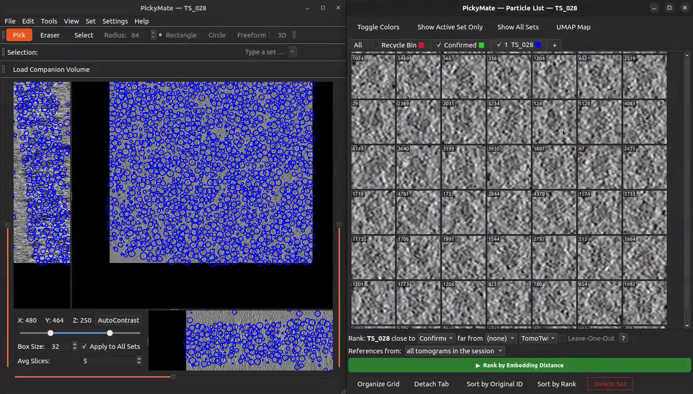

Even the single distance (far from `(none)`) is impressive. Setting **far
from** `Recycle Bin` — the accumulated rejections, including TS_027's
nucleus — is better still. Boundary artefacts and a few false positives
remain and need cleaning by hand, but you are starting from a much cleaner
list: in the recording, 214 particles are confirmed in the first sweep and
688 in the next.

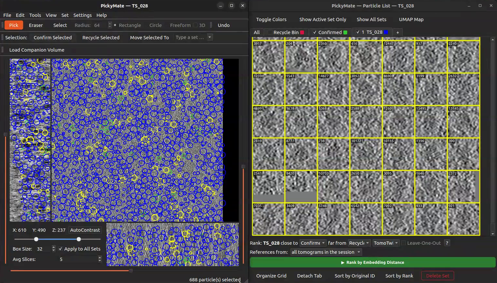

As you confirm in TS_028, those particles join the pooled references, so each
re-rank improves here as well. Press **UMAP Map** to see where the confirmed
particles of this tomogram sit: they form a tight cluster. Lassoing that
cluster still pulls in some false positives, so use it to inspect, not to
decide.

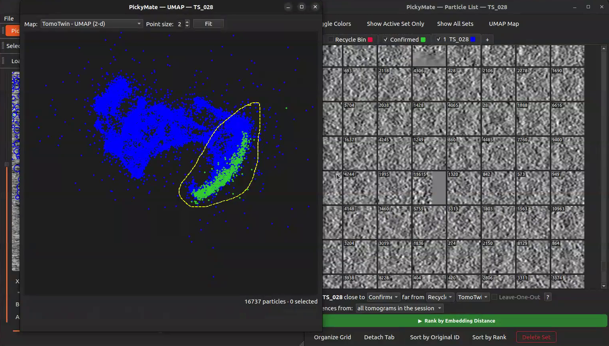

## 12. One UMAP map for the whole session

The per-tomogram UMAPs come from TomoTwin and are not comparable between
tomograms. PickyMate can fit one map on the full embeddings of every
tomogram together. In the UMAP window, open the **Map** list and choose
**All 2 tomograms — TomoTwin full**, then press **Compute**.

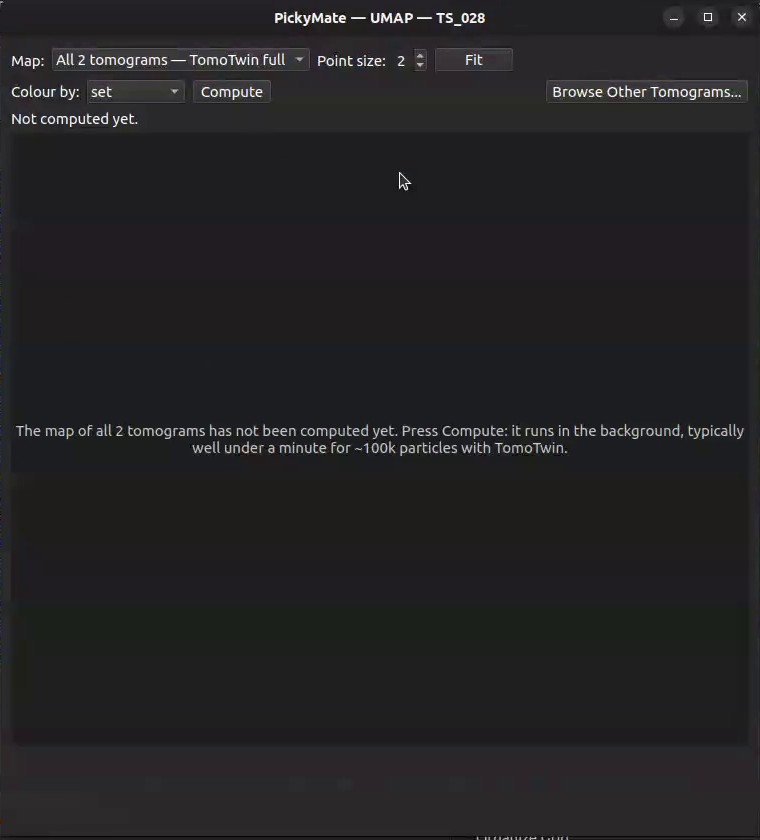

It runs in the background — 24,922 particles × 32 dimensions here, well under
a minute even on a modest laptop — and the result is cached next to the
manifest (`.pickymate_session/umap_tomotwin.npz`) until the embeddings
change.

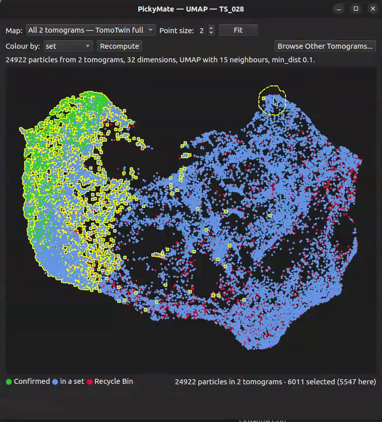

Coloured **by set**, the confirmed particles of both tomograms fall in the
same lobe of the map; coloured **by tomogram**, the two tomograms blend into
each other, which means their embeddings live in one compatible space.

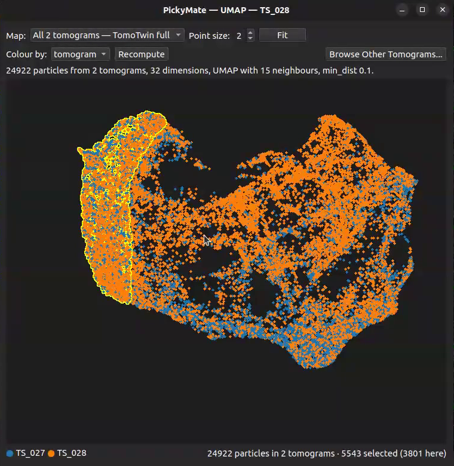

A lasso on this map selects across the whole session: the open tomogram's
particles land in its **UMAP Selection** tab, the other tomograms' are saved
to their working directories (the navigator's *UMAP selected* column counts
them), ready when you open each one. **Browse Other Tomograms...** shows
those particles as thumbnails read straight from disk. Since you now know
which lobe holds the ribosomes, lassoing it is a quick way to pre-select the
likely true positives of a tomogram you have not opened yet — then inspect
and confirm them there.

## 13. Where your work is saved

Picks save automatically, continuously, as plain text next to your data —
there is no save step. After the session the tutorial folder looks like this:

```
Tutorial/
├── session.csv
├── .pickymate_session/
│   └── umap_tomotwin.npz      ← cached session map (safe to delete)
├── TS_027_picks/
│   ├── TS_027.txt             ← picks not yet decided on
│   ├── Confirmed.txt
│   ├── Recycle Bin.txt
│   ├── UMAP Selection.csv     ← the current lasso selection, if any
│   └── embeddings.settings    ← which embedding files are attached
└── TS_028_picks/
    └── (same)
```

Each set file is comma-separated with a header, `x,y,z,uid,embedding_row,score`:
voxel coordinates, the particle's stable id, the row of the embedding files it
comes from, and its last ranking score. `Confirmed.txt` is what you would pass
on to subtomogram averaging. Running `pickymate --session session.csv` again
resumes exactly where you left off.

At the end of the recording the folder holds 656 confirmed ribosomes for
TS_027 and 902 for TS_028, with most of TS_028 still to review.

## Shortcuts used in this tutorial

| Action | How |
|---|---|
| Send a particle to the Recycle Bin | **Shift+click** (gallery or tomogram view) |
| Send a particle to Confirmed | **Space+click** |
| Toggle a particle in the selection | **Ctrl+click** |
| Range-select in the gallery | click the first, **Alt+click** the last |
| Send this and everything after it to the Recycle Bin | **Shift+Ctrl+click** (gallery) |
| Confirm / recycle every selected particle | **Insert** / **Delete**, or the Selection toolbar |
| Clear the selection | **Escape** |
| Step through Z | bottom slider, or **Shift+wheel** |
| Zoom / pan | wheel / right-drag (tomogram views, gallery, UMAP map) |
| Next / previous tomogram | **Ctrl+PgDown / Ctrl+PgUp** |
| Undo / redo | **Ctrl+Z / Ctrl+Y** |
| Full list | **F1** (Help > Keyboard Shortcuts) |

For the rest of the interface see the
[PickyMate documentation](https://github.com/MohamadHarastani/PickyMate/tree/main/docs).
