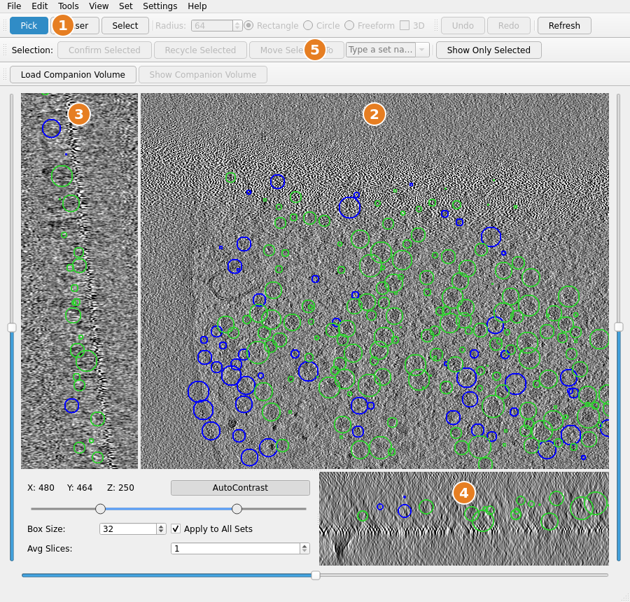

# Getting Started

## Installing

```
git clone https://github.com/MohamadHarastani/PickyMate.git
cd PickyMate
conda env create -f environment.yml
conda activate pickymate
```

This creates a conda environment named `pickymate` with PickyMate installed
as the `pickymate` command, in editable mode: the command runs the code in
the cloned folder, so updating the clone needs no reinstall. Alternatives,
into an environment you already have:

```
pip install -e .        # from inside the clone
pip install git+https://github.com/MohamadHarastani/PickyMate.git
```

## Running

One tomogram:

```
pickymate tomogram.mrc [options]
```

A whole dataset at once — see [Sessions and UMAP Maps](sessions-and-umap.md):

```
pickymate --session session.csv
```

The typical start, importing template-matching picks with both embedding
methods attached:

```
pickymate TS_026.rec \
    --embedded_particle_list picks/TS_026.txt \
    --tomotwin_embeddings tomotwin/TS_026.temb --tomotwin_umap tomotwin/TS_026.tumap \
    --cryosiam_embeddings cryosiam/TS_026_embeds.h5 --cryosiam_umap cryosiam/TS_026_umap.csv
```

### Options

- `--working_dir DIR` — store/load picks in `DIR` instead of the default
  `<tomogram>_picks` next to the tomogram.
- `--particle_lists PATH [PATH ...]` — plain `x y z` text files, each
  imported as its own new set (a taken name gets a numeric suffix).
- `--embedded_particle_list PATH` — one `x y z` file to import *with
  embeddings attached*, enabling [ranking](ranking.md).
- `--tomotwin_embeddings PATH` / `--tomotwin_umap PATH` — TomoTwin `.temb`
  and `.tumap` files for those picks. The `.temb` carries its own
  coordinates, so `--embedded_particle_list` is optional with TomoTwin (and
  cross-checked if given).
- `--cryosiam_embeddings PATH` / `--cryosiam_umap PATH` — CryoSIAM `.h5`
  embeddings and UMAP `.csv`. The `.h5` has no coordinates, so
  `--embedded_particle_list` is required with CryoSIAM.
- Both methods can be given at once; each shows up as its own ranking space.
- `--companion_tomogram PATH` — a second version of the same tomogram (e.g.
  denoised), switchable in the View menu. Loaded only when first switched to.
- `--native_memmap` — read tomograms from disk at their exact on-disk dtype
  instead of loading into RAM; slower access, much lower memory.

Import options are only needed the first time: everything is recorded in the
working directory, and later launches of `pickymate tomogram.mrc` resume
from it.

## The two windows



1. **Tools toolbar** — Pick, Eraser, Select; exactly one is active. See
   [Picking and Tools](picking-and-tools.md).
2. **XY view** — the main slice view at the current Z; the bottom slider and
   Shift+wheel step through Z.
3. **ZY view** — stepped through X by the far-left slider.
4. **XZ view** — stepped through Y by the slider beneath it.
5. **Selection toolbar** — acts on the currently selected particles. See
   [Selection, Undo, and Saving](selection-and-saving.md).

The second window, the **Particle List**, is the thumbnail gallery and where
sets are managed — see [The Particle List](particle-list.md).
