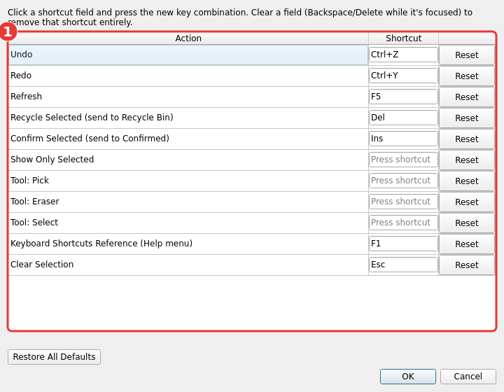

# Keyboard Shortcuts

| Action | Shortcut |
|---|---|
| Add particle | Click empty space (tomogram view, Pick tool) |
| Move particle | Click + drag (tomogram view, Pick tool) |
| Switch active picking class + gallery tab | 1-9 |
| Reorder a set's tab | Drag it in the gallery |
| Pan | Right-click + drag (tomogram view or gallery) |
| Zoom | Mouse wheel |
| Step depth/slice | Shift + wheel (tomogram view) |
| Send to Recycle Bin / delete from bin | Shift + click |
| Send this + rest of list to Recycle Bin | Shift + Ctrl + click (gallery) |
| Send to Confirmed | Space + click |
| Multi-select toggle | Ctrl + click (gallery or tomogram view) |
| Multi-select range | Alt + click (gallery) |
| Send every selected particle to Recycle Bin | Delete |
| Send every selected particle to Confirmed | Insert |
| Navigate to the neighboring particle | Arrow keys (gallery) |
| Shape-select (rectangle/circle) | Click + drag, Select tool active |
| Shape-select (freeform) | Click to place points, Select tool active |
| Finish freeform selection | Double-click, Enter, or click near the start point |
| Undo last freeform point | Backspace (while placing points) |
| Cancel freeform selection | Escape |
| Clear the current selection (anywhere in the app) | Escape |
| New set | Click the gallery's "+" tab |
| Rename set | Double-click its tab |
| Undo | Ctrl+Z |
| Redo | Ctrl+Y, Ctrl+Shift+Z, or your platform's native Redo key |
| Open this reference | F1 |

This same reference is available in-app from **Help > Keyboard Shortcuts**
or by pressing **F1** from anywhere.

## Customizing shortcuts

**Settings > Customize Keyboard Shortcuts...** lets you rebind most of the
shortcuts above:

1. Click a shortcut field and press the new key combination. **Reset**
   restores that one row's default; **Restore All Defaults** resets
   everything. Two shortcuts assigned to the same key are flagged in red
   (only one of them would actually respond), but you can still save
   anyway if you want to sort it out later.

This is entirely optional — nothing is written to disk until you actually
change a shortcut, and it lives in `~/.config/pickymate/shortcuts.json` (or
`$XDG_CONFIG_HOME/pickymate/shortcuts.json`), separate from any tomogram's
own picks.
