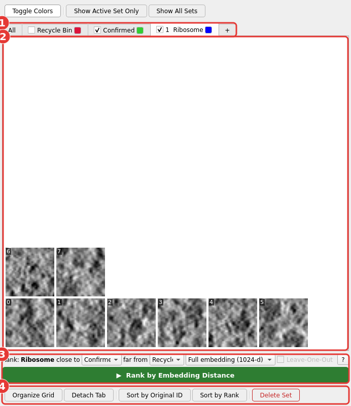

# The Particle List

The Particle List window is the thumbnail gallery, and also where sets are
managed directly through its tabs — there's no separate Sets window.

1. **Tabs** — one per set, plus the fixed **All**, **Recycle Bin**,
   **Confirmed**, and **+** tabs. Each normal set's tab shows its number-key
   position and a checkbox controlling its visibility in the tomogram views.
2. **Thumbnail grid** — every particle in the current tab's set, each
   showing its numeric ID.
3. **Ranking row** — see [Ranking by Embedding Distance](ranking.md).
4. **Gallery toolbar** — Organize Grid, Detach Tab, sort buttons, and
   Delete Set / Empty Recycle Bin.

## Sets management

- The **+** tab (always last) prompts for a name and creates a new set.
- **Double-click** a set's tab to rename it.
- **Delete Set** deletes the current tab's set, sending every particle in
  it to the Recycle Bin (disabled on All, +, Recycle Bin, and Confirmed).
- Each set's tab has its own **visibility checkbox**, independent of which
  tab you're currently looking at — any number of sets can be visible in
  the tomogram views at once.
- Each tab also has a **color swatch** showing that set's current color —
  click it for **Choose Color...** (any color, not just the palette) or to
  revert it (**Reset to Automatic** for a normal set, **Revert to
  Red**/**Revert to Green** for Recycle Bin/Confirmed, which can be
  recolored too). A manually-set color is remembered across restarts and
  is never touched by Toggle Colors.
- **Empty Recycle Bin** (only shown while the Recycle Bin tab is active)
  archives every particle it holds to a hidden, timestamped backup file
  (`.recyclebin_<date>_<time>`) in the working directory first — not
  loaded back as a set on the next launch, but recoverable by hand if you
  ever need to — and is still undoable with Ctrl+Z right after.
- Switching to a set's tab also makes it the active picking class.
- **Reordering tabs** — drag a normal set's tab to put your own sets in
  whatever order you like; number keys then follow that order (tab 1 is
  always whichever set is currently first). All, Recycle Bin, Confirmed,
  and + stay fixed in place and can't be dragged.

## Gallery toolbar

- **Toggle Colors** rotates every set still on its automatic color to the
  next one in the palette at once — Recycle Bin/Confirmed's own red/green
  (and the yellow selection highlight, which is always fixed) aren't part
  of that rotation, though either can still be recolored manually via its
  own tab's color swatch. Any manually-set color, on any set, is left
  alone by Toggle Colors too.
- **Show Active Set Only** shows only the active tab's set, hiding every
  other one, and keeps following whichever tab you switch to (including
  by number key, and Recycle Bin/Confirmed, without making either the
  active picking class) — handy for flipping through sets one at a time.
  Following the All tab shows every set instead, matching what All itself
  displays. Turning it off restores exactly the visibility you had before
  turning it on. While it's on, the gallery's per-tab visibility
  checkboxes are grayed out.
- **Show All Sets** is a one-shot button that makes every set visible and
  turns Show Active Set Only off if it was on.
- **Organize Grid** compacts gaps left by deleted particles; **Detach Tab**
  pops a set's grid into its own window (close it, or its Reattach button,
  to dock it back).

## Browsing and selecting

- The **All** tab groups particles by category (Recycle Bin, Confirmed,
  then your sets alphabetically) instead of mixing them, with a colored
  border per category.
- **Click** — select and jump to that particle in the tomogram views.
  **Ctrl+click** toggles one item in/out of a multi-selection;
  **Alt+click** range-selects from the last clicked item. **Arrow keys**
  navigate to the neighboring particle.
- A particle selected in the gallery is outlined **yellow** in the
  tomogram views too — only for selection, never while you're just picking
  or dragging.
- **Right-click + drag** pans the gallery (does not select). The mouse
  wheel zooms in/out, centered on the selected particle if one exists,
  otherwise on the cursor.
