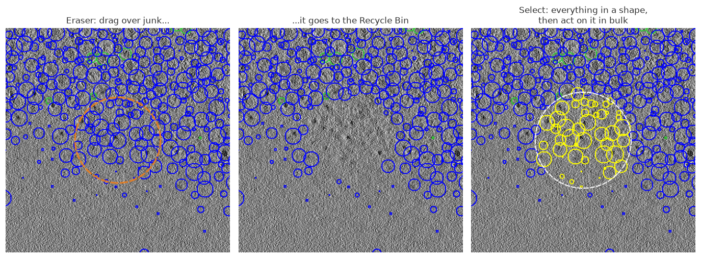

# Picking and Tools

## Pick / Eraser / Select

Three mutually exclusive tools live in the **Tools** toolbar; the active
tool's options sit right beside the buttons:

- **Pick** (default) — click empty space to add a particle; click + drag an
  existing one to move it.
- **Eraser** — click-drag to send every particle within **Radius** of the
  cursor to the Recycle Bin.
- **Select** — drag a **Rectangle** or **Circle** (or click points for
  **Freeform**) to select every particle inside. Non-destructive: act on the
  result with the Selection toolbar or the keyboard.

Eraser and Select share one **2D/3D** checkbox:

- **2D** — only particles visible on the current slice.
- **3D** — the Eraser clears a full sphere; Select extrudes the shape through
  the whole volume.

Freeform: click to place points, finish with a double-click, Enter, or a
click near the start; Backspace removes the last point, Escape cancels.

## Recycle Bin, Confirmed, and cleanup

Two fixed categories always exist alongside your own sets — they are what
[ranking](ranking.md) learns from:

- **Shift+click** a particle → **Recycle Bin**. Shift+click one already in
  the bin deletes it (undoable). In the gallery, **Shift+Ctrl+click** sends
  that particle and everything after it.
- **Space+click** a particle → **Confirmed**.
- The Recycle Bin starts hidden; each set's tab has its own visibility
  checkbox in the gallery.
- **Number keys 1–9** switch to the matching set tab — the number shown on
  the tab itself.
- **Empty Recycle Bin** archives to a hidden timestamped file first; nothing
  is ever discarded outright.

## Box size and contrast

- **Box Size** applies to all sets while **Apply to All Sets** is checked;
  uncheck it to size each set independently. Values apply on Enter, not per
  keystroke.
- **AutoContrast** (default) continuously stretches each view. Dragging the
  **Contrast** slider switches to manual levels, applied identically to all
  views and thumbnails; re-check AutoContrast to go back.
- **Avg Slices** averages that many slices into each view — a mean, so noise
  drops without changing brightness.
