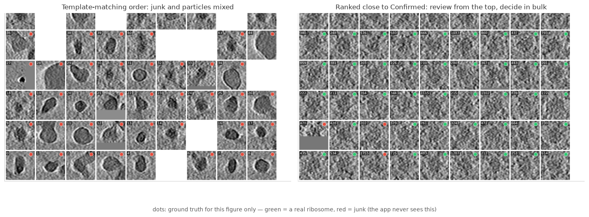
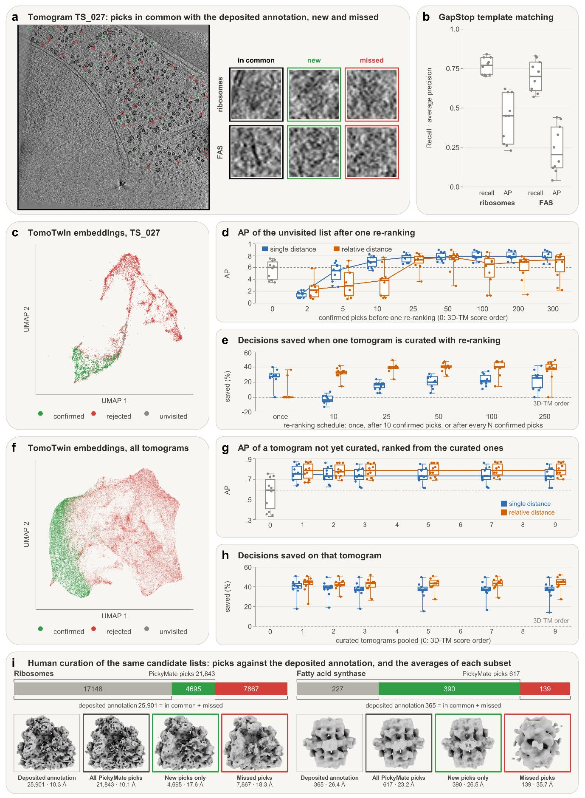

# Ranking by Embedding Distance

This is the heart of PickyMate. Each imported pick carries an embedding
vector from a foundation model; as you fill **Confirmed** and the **Recycle
Bin**, any set can be re-ranked by Mahalanobis distance to those examples —
so the particles most like your confirmed ones surface first, and you decide
in bulk instead of in pick order.

## Bringing embeddings in

Embeddings attach when a particle list is imported: from the command line
(`--embedded_particle_list` with `--tomotwin_embeddings` /
`--cryosiam_embeddings` and their `--*_umap` companions — see
[Getting Started](getting-started.md)) or from **File > Import Particle List
with Embeddings...**. Attaching both methods at once is fine; **File >
Attach Embeddings to Current Particles...** adds a second method later.

Every attached method contributes its full embedding and, when given, its 2D
UMAP as separate **ranking spaces** — e.g. *TomoTwin - full (32-d)*,
*TomoTwin - UMAP (2-d)*, *CryoSIAM - full (1024-d)* — selectable in the
ranking row's space dropdown, so the same picks can be ranked by either
method and compared.

## The ranking row

At the bottom of the Particle List, above its toolbar:

- **Rank ... close to** — the reference set to resemble. Lower score = more
  like this set. Usually **Confirmed**.
- **far from** — optional second reference to move away from, usually the
  **Recycle Bin**: the score becomes
  `distance_to(close to) − distance_to(far from)`. Left at **(none)**, the
  plain single distance is used. The two can't be the same set.
- **space dropdown** — which embedding to measure in.
- **Leave-One-Out** — only when a reference is the current tab itself:
  excludes each particle from the statistics it is scored against, so
  nothing trivially matches itself.
- **References from** — appears in a [session](sessions-and-umap.md): pool
  the reference sets of *this tomogram*, *all tomograms*, or *chosen
  tomograms*. Decisions made in finished tomograms then rank a fresh one
  before you have confirmed anything in it.
- **▶ Rank by Embedding Distance** — computes the scores and sorts the
  current tab by them.

Mahalanobis distance measures how many standard deviations a particle sits
from the reference set's mean, accounting for how the reference spreads in
embedding space — not a plain Euclidean distance.

## After ranking

The result reports how many particles were scored (a particle without an
embedding is skipped). The current tab is laid out best-first; ranking is a
one-shot sort, so later edits don't reshuffle it. **Sort by Rank** in the
toolbar re-applies the last scores at any time; **Sort by Original ID**
returns to pick order. Re-rank whenever you have confirmed or rejected more —
it takes about a second, which is what makes the confirm-a-few, re-rank,
sweep-in-bulk loop work.

## What it buys you

Measured on the ten defocus tomograms of EMPIAR-10988, ribosomes, TomoTwin
embeddings, with a simulated curator who knows the deposited annotations
(**a**–**c**: the data; **i**: the human curation, validated by subtomogram
averaging):

- **d** — one re-ranking after only 50 confirmed picks raises the average
  precision of the unvisited list from 0.56 to 0.78; from about 25 confirmed
  picks on, every tomogram improves.
- **e** — re-ranking during the curation saves 26% of the decisions with the
  single distance (once, early) and 39% with the relative distance, *far
  from* the Recycle Bin (repeatedly); rejecting everything outside a
  region-of-interest mask first brings it to 47%.
- **g, h** — the picks of one curated tomogram rank the next one about as
  well as its own picks would, saving about 40% of its decisions before a
  single decision is taken in it; the gain holds as more tomograms are
  pooled.

The experiments are reproducible with
[tools/benchmarking/](../tools/benchmarking/), which calls the same ranking
code as the application.
