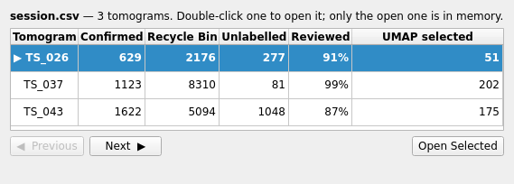
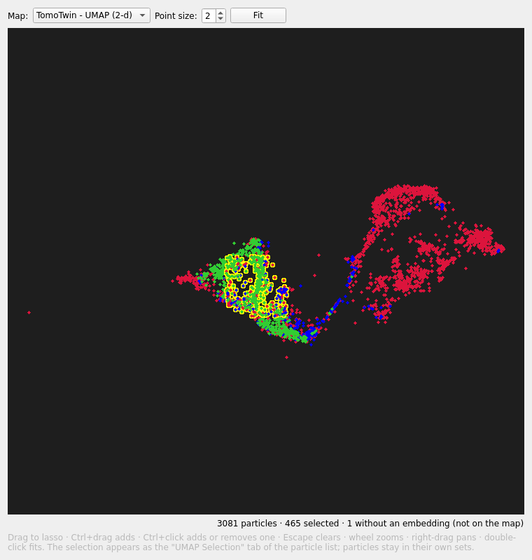

# Sessions and UMAP Maps

## Sessions: a whole dataset at once

A session opens many tomograms as one job:

```
pickymate --session session.csv
```

`session.csv` has one row per tomogram, with the same columns as the
single-tomogram options (relative paths resolve against the manifest's
folder; only `tomogram` is required):

```
tomogram,working_dir,embedded_particle_list,cryosiam_embeddings,cryosiam_umap,tomotwin_embeddings,tomotwin_umap,companion_tomogram
../Tomograms/TS_026.rec,TS_026_picks,../picks/TS_026.txt,...
```



The **navigator** lists every tomogram with its progress, read live from the
working directories. Double-click one to open it (**Ctrl+PgDown /
Ctrl+PgUp** step to the next/previous). Only the open tomogram is in memory;
switching saves everything first, and the next tomogram is pre-loaded in the
background. Import columns are used only on a tomogram's first open — after
that its working directory is simply resumed.

**References from** in the [ranking row](ranking.md) is the payoff: rank a
tomogram's picks close to the pooled Confirmed (and away from the pooled
Recycle Bin) of every tomogram you already finished — before making a single
decision in the new one.

## The UMAP map

**View > UMAP Map...** (or the gallery's **UMAP Map** button) shows every
embedded particle of the open tomogram at its 2D UMAP position, colored by
set, updating live as you work:



- **Drag** to lasso a selection; **Ctrl+drag** adds a region; **Ctrl+click**
  adds or removes one particle; **Escape** clears. Wheel zooms, right-drag
  pans, double-click fits.
- The selection becomes the **UMAP Selection** tab in the Particle List — a
  view like All, grouped and color-bordered. Particles never leave their
  sets; confirm or recycle them right from that tab. **Show Active Set
  Only** on it shows just those particles in the tomogram views.
- The selection is saved (`UMAP Selection.csv` in the working directory) and
  restored on reopen.

## The session map

In a session, the map's **Map** list also offers **All N tomograms** — one
UMAP fitted on the full embeddings of every tomogram together, so positions
are comparable across tomograms and one lasso selects across the whole
dataset. Press **Compute** the first time: it runs in the background with
progress and a Cancel button (about a minute for ~100k picks with TomoTwin),
and the result is cached next to the manifest until the embeddings change.

- Color by **set** or by **tomogram** (well-mixed tomogram colors mean the
  tomograms share one embedding space).
- A lasso selects in *every* tomogram: the open one's particles land in its
  UMAP Selection tab, the others' are saved to their working directories
  (the navigator counts them), ready when you open each tomogram.
- **Browse Other Tomograms...** shows the selected particles of the not-open
  tomograms as thumbnails read straight from their files — view only; open a
  tomogram to act on its particles.
